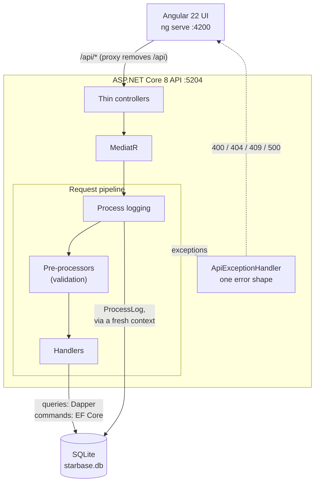
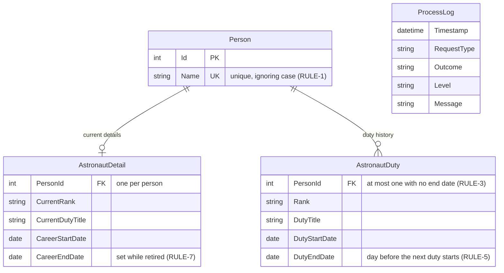

# Stargate: Astronaut Career Tracking System (ACTS)

BAM's technical exercise, completed: a .NET 8 API that tracks people and their astronaut duties, and an Angular 22 app for browsing and updating them.

- **The spec:** [`tech_exercise/package/exercise1/README.md`](tech_exercise/package/exercise1/README.md), BAM's original, unchanged.
- **The plan, rubric and decisions:** [`docs/PLAN.md`](docs/PLAN.md). Every rule and requirement in the spec is quoted there with how it was interpreted, the tasks that address it, and the tests that prove it.

## Run it

You need the **.NET 8 SDK** (a newer SDK works if the .NET 8 runtime is installed) and **Node.js** 22.22.3+, 24.15+ or 26+ (Angular 22's requirement).

The UI and the API are separate processes, so use **two terminals**.

**1. The API**, on http://localhost:5204 (Swagger at http://localhost:5204/swagger):

```bash
cd tech_exercise/package/exercise1/api
dotnet run --launch-profile http
```

In Development, the first start creates `starbase.db` from the EF migrations and seeds demo data: a non-astronaut, an active astronaut, a retiree and someone who returned to service. To reset it, stop the API, delete `api/starbase.db` and start it again.

**2. The UI**, on http://localhost:4200:

```bash
cd tech_exercise/package/exercise1/ui
npm install
npm start
```

The dev server forwards `/api/*` to the API, so no CORS setup is needed. If the UI says *"The API couldn't be reached. Is it running?"*, start the API first.

## Test it

From `tech_exercise/package/exercise1`:

| What | Command |
|------|---------|
| API tests (95) | `dotnet test Stargate.sln` |
| The tests for one criterion | `dotnet test Stargate.sln --filter "AC=RULE-5"` (any ID from the rubric) |
| API coverage | `dotnet test Stargate.sln --collect:"XPlat Code Coverage"`, then `dotnet tool restore` and `dotnet reportgenerator -reports:"tests/StargateAPI.Tests/TestResults/*/coverage.cobertura.xml" -targetdir:coverage -reporttypes:Html` |
| UI tests (83) | `cd ui && npx ng test --watch=false` |
| The UI tests for one criterion | `cd ui && npx ng test --watch=false --filter "\[UI-2\]"` |
| UI coverage | `cd ui && npx ng test --watch=false --coverage` |

Coverage on 2026-10-26: **API 100% of lines** (EF's generated migrations excluded), **UI 99.4% of lines**.

## How it's built



- **API** (`api/`): controllers only forward to MediatR. Each use case is a request with a pre-processor that validates it and a handler. Queries read with parameterised Dapper SQL and commands write with EF Core. One exception handler turns every failure into the same response shape the successes use (`success`, `message`, `responseCode`). Every request that reaches the pipeline is written to a `ProcessLog` table, successes and failures alike. Reading the log itself isn't logged, and neither is malformed JSON, which ASP.NET rejects before the pipeline runs.
- **Tests** (`tests/`): xUnit through the real MediatR pipeline, on an in-memory SQLite database built by the real migrations, plus HTTP tests of the whole app. Each test is tagged with the rubric criterion it proves.
- **UI** (`ui/`): Angular 22 with standalone components, signals and no zone.js, plus Angular Material. See [`ui/README.md`](tech_exercise/package/exercise1/ui/README.md).

### Data model

The database enforces the key rules itself: names are unique ignoring case, and a person can have at most one current duty (a duty with no end date).



### Endpoints

| Method | Path | Does |
|--------|------|------|
| GET | `/Person` | Everyone, with their current astronaut details |
| GET | `/Person/{name}` | One person; names ignore case and surrounding spaces |
| POST | `/Person` | Add a person; the body is a JSON string, e.g. `"John Doe"` |
| PUT | `/Person/{name}` | Rename a person; the body is the new name as a JSON string |
| GET | `/AstronautDuty/{name}` | A person's details and all their duties, newest first |
| POST | `/AstronautDuty` | Add a duty: `{ name, rank, dutyTitle, dutyStartDate }` |
| GET | `/ProcessLog?take=20` | The most recent process log entries, newest first |

Errors use the same JSON shape: 400 for invalid input or a broken rule, 404 for an unknown person, 409 for a conflict (a duplicate name, or two simultaneous changes), 500 with a generic message for anything unexpected.

## What changed

The full record, with the reasoning behind each decision, is in [`docs/PLAN.md`](docs/PLAN.md) (tasks T01–T41, decisions D1–D18). In short:

**Bugs fixed in the original code**
- `GET /AstronautDuty/{name}` ran the wrong query and returned no duties.
- Every Dapper query built SQL from user input, so a name like `' OR 1=1 --` was an SQL injection and `O'Brien` crashed. They're now parameterised.
- Duplicate names were accepted, because the pre-processor that checks them was never registered.
- One person's duty could block another person's, because the duplicate check ignored who it belonged to.
- A backdated duty corrupted the history, giving the previous duty an end date before its start.
- A first duty of RETIRED gave the wrong career end date.
- An unknown name returned 200 with nothing, or crashed.
- Errors leaked internal exception messages, and one endpoint had no error handling at all.

**The rules, now enforced** (decisions in `docs/PLAN.md`)
- Names are unique ignoring case, and enforced by the database (D4).
- A new duty must start after the current one (D1). The database itself allows only one current duty per person (D14).
- RETIRED can't be a first duty or follow a retirement. A later duty returns a retired person to service (D2).
- Input is trimmed and validated (D13).

**Added**
- Renaming a person (D16).
- Process logging to the database, which survives a failed save (D17).
- Swagger documentation, and the Angular app (D18): a people list with search and filters, a person page with a duty timeline, add, rename and add-duty dialogs, progress states, and a recent-activity feed.
